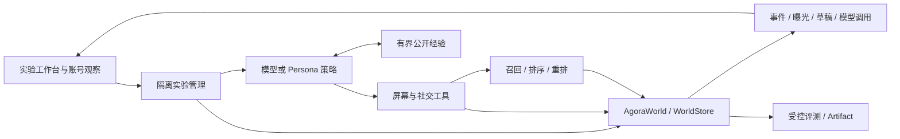

# Agora 系统设计

原生社交世界、账号行为和研究实验分别拥有自己的状态与协议。

每个运行世界具有独立 SQLite 和媒体副本，一个后台写者。HTTP 观察使用只读事务，避免
把部分动作结果展示为完整状态。嵌套动作由 savepoint 接管，失败回滚会话和新增媒体。

用户策略、推荐器、受众评估和独立 Observer 各有职责：用户策略根据公开观察行动；推荐
决定曝光；评估不通过直接修改排名制造反馈。沙盒允许曝光内生变化；Arena 控制内容池/
曝光/预算。不同模式不能无条件混合指标。

多媒体文件按内容寻址，数据库保存有序附件、角色、alt text 与 transcript。模型素材来自
账号白名单，VLM 真正接收当前屏幕图片/视频帧，base64 只留在请求。视频完整产品交互和
自动 OCR/ASR 后续扩展。

模型调用、实际动作、公开理由和结果分开记录，模型身份与失败可审查。回放只读取历史
快照，不重新推理。配置、种子、数据库/媒体指纹明确标识实验初始条件。未报告 token 的
调用不等于实际零成本；页面只展示已知用量。

当前实现与边界见 [运行协议](simulation.md)、[路线](agora-roadmap.md) 和
[验证记录](validation.md)。历史 runtime 位于 `third_party/oasis/`，不进入原生主路径。
