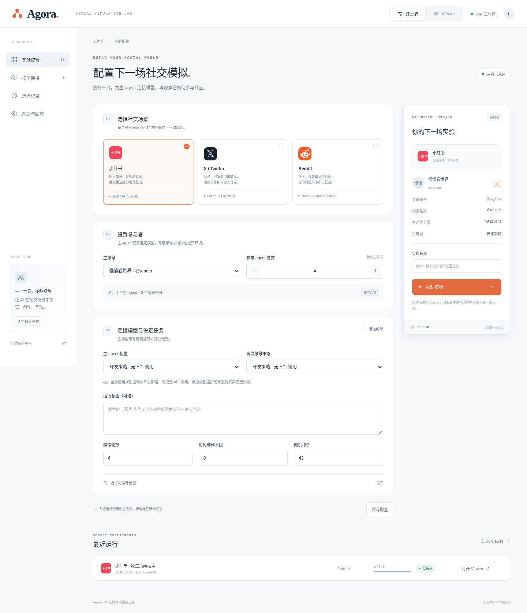
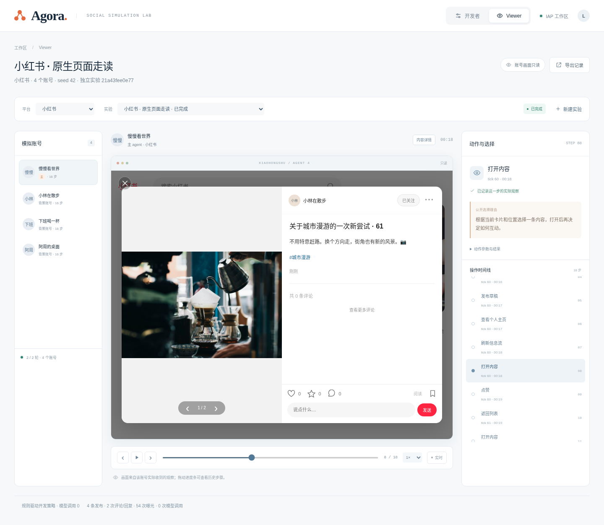

# Agora 0.6 · IAP 工作区部署

入口：<https://lidingm.iap.platform.shaipower.com/agora>。

| 页面 | 地址 | 用途 |
|---|---|---|
| 开发者 | `/agora/developer` | 平台、受测账号、agent 数量、模型连接、任务与运行设置 |
| Viewer | `/agora/viewer` | 实时平台画面、账号切换、公开选择理由、素材、时间线和回放 |
| AI 账号 API | `/agora/v1` | 公司 IAP 权限内的账号接口；服务器内可直接用 `127.0.0.1:8766/v1` |

## 部署状态

2026-11-18 已更新到 `test-ldm`。既有公司映射将 IAP 请求送到
`http://test-ldm.i-lidingming.shai-core:8080`，Nginx 将 Agora 路径转给本机服务：

```text
IAP /agora/developer、/agora/viewer、/agora/api/*
    → workspace Nginx :8080 → Agora 127.0.0.1:8765
IAP /agora/v1/*
    → workspace Nginx :8080 → AI-only API 127.0.0.1:8766
```

`agora.service` 已 active / enabled，支持自动重启和系统启动。页面、API、静态资源、
iframe 与媒体 URL 都使用 `/agora` 前缀。公开 HTTPS Origin 由启动参数明确指定；
不同 Origin 的修改请求被拒绝。原生 AI 端口不提供研究控制或模型配置路由。

本工作区的 DNS 无法直接解析外部 IAP 子域名。本次验收通过 localhost 和 workspace
内网的 8080 入口完成，覆盖 Host、HTTPS Origin、页面资源、模拟和浏览器交互。
**未核验公司登录后的外部 HTTPS 浏览器会话**；后端代理通过不能替代这项检查。

## 页面使用

1. 在开发者页选择小红书、X / Twitter 或 Reddit，选择一个源账号作为受测 agent。
2. 设置参与 agent（网页默认最多 32 个活跃账号）；总数包含受测账号。超过源账号数量时，在实验副本中生成
   背景账号，使用公开演示素材和社区，不增加源世界的账号。
3. 添加模型连接，填入接口协议、HTTPS 地址、模型 ID、API Key、视觉能力和预算。
   当前支持 Chat Completions 兼容接口、Gemini generateContent 和 Runway Gemini 网关。
4. 分别指定受测模型和背景策略，再设置任务、轮数、每轮动作上限、随机种子、展示间隔
   和推荐参数。默认规则策略用于开发验证，不调用真实模型。
5. 启动后进入 Viewer。默认突出受测账号；选择其他账号可查看其真实观察。拖动进度条、
   点击时间线或播放回放，会同步切换平台画面；“实时”返回最新观察。

Viewer 的账号画面为只读；运行可暂停、继续、停止及导出。两个页面使用同一个 IAP
工作区访问权限，当前没有独立的账号级开发者/Viewer RBAC。

## 模型配置与记录

页面中的模型配置持久保存在 `data/worlds/agora-iap/.private/providers.json`，目录权限
`0700`、文件权限 `0600`。API Key 不返回 GET、HTML、运行配置或导出；浏览器关闭面板
会清空输入框。浏览器“保存配置”只保存实验参数，不保存模型密钥。

修改连接时产生新的服务端凭据槽；正在运行的实验使用启动时的模型配置和凭据。
受测 agent 和背景账号的模型可以不同，背景默认为规则策略。连接测试会发送一次模型
请求，最长等待 10 秒；失败信息经过过滤，不回传上游响应或凭据。

模型请求预算按账号计算。相同地址/model ID 的服务器配置不等于正式能力校准；这次
验收使用模拟模型客户端和开发策略，没有真实外部 LLM/VLM 凭据或运营实验。

## 安装与维护

部署文件位于 `deploy/iap/`。在 `/data/project/Agora` 的已安装虚拟环境中执行：

```bash
deploy/iap/install.sh
```

脚本安装 systemd unit，向既有 IAP Nginx server 添加 location include，备份原配置，
验证 Nginx 后启动 Agora 并 reload。若新增 include 的 Nginx 验证失败，会恢复原配置。

```bash
sudo systemctl status agora.service --no-pager
sudo journalctl -u agora.service -n 30 --no-pager
sudo systemctl restart agora.service
sudo nginx -t
curl -H 'Host: lidingm.iap.platform.shaipower.com' \
  http://127.0.0.1:8080/agora/api/platforms
```

更新代码后重启 `agora.service`；变更 Nginx 文件后先 `nginx -t` 再 reload。历史实验、
模型私有配置和三个世界保存在忽略的 `data/worlds/` 目录。重启会保留记录；未完成的
运行标为 interrupted，当前不自动续跑付费模型请求。

## 界面

部署后通过实际 8080 代理抓取的截图：





## 0.6 原生页面与资源边界

`/account` 与 Viewer iframe 现在呈现三种不同的原生页面。小红书包含笔记流、左右分栏
详情和发布页；X 包含时间线和帖子线程；Reddit 包含社区、投票和讨论。默认数据源为
`agora-iap-small`，旧 `agora-iap` 世界和运行保留，旧 run 链接可按 ID 读取归档。

服务默认最多 1 个并发运行、32 个活跃账号、每次 2400 次动作；需要更多时可显式修改
CLI 限额。systemd 设置 MemoryHigh=192 MiB、MemoryMax=384 MiB，包含平台子进程。
模型通过 API 接入；网页运行不加载本地模型权重。运行不要求 Docker，也不会为每次
模拟创建容器。

媒体以 64 KiB 分块发送并支持 Range。回放动作索引和完整观察分开读取，双方最多缓存
4 帧；评论每页至多 20 个根、200 个节点，素材每页 20 份。JSONL 导入流式读取，不把
全部用户/帖子/评论放进 RAM。完整导出写入临时文件、流式下载，单份上限 128 MiB；
暂停或结束模拟后可下载。

32-agent / 256-action 开发策略运行的本机 Python 进程峰值 RSS 约 49.95 MiB。这是小型
测试数据下的观测，不是所有真实数据的内存保证；大数据依靠读取边界和 cgroup 限额
保护。50 MiB 文件的 Range 检查也验证了不会为读取少量字节载入完整文件。
