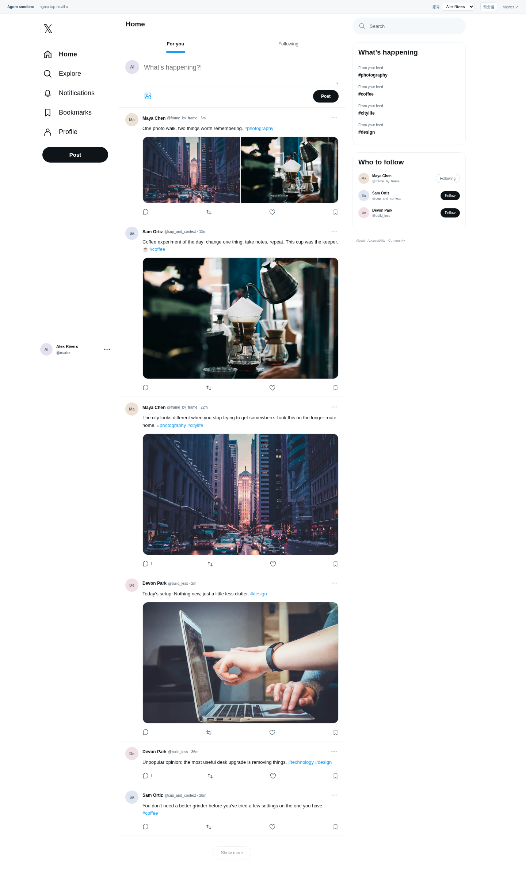

# 三个平台的交互与分发对齐

核对日期：2026-11-18。Agora 提供平台页面、工具、内容、关系和分发机制的可运行近似。
页面按各自产品组织，不在一个通用“社媒页面”中替换标题；所有页面使用同一套后台实体
和动作，Viewer 在这些页面里展示保存的账号观察。

| 平台 | 页面与主要操作 | 有机内容分发近似 | 示例人物风格 |
|---|---|---|---|
| 小红书 | 发现/关注/附近、笔记瀑布流、左右分栏笔记详情、图集翻页、点赞/收藏专辑、评论回复、作者编辑/删除、发布页 | 兴趣与关注召回，点击、收藏、评论、时效、重复曝光疲劳；对曝光少的新内容保留试探空间 | 日常记录、简短经验、具体使用感受和问答；话题与适量 emoji |
| X / Twitter | 黑白时间线、For you/Following、帖子/回复线程、转发/引用、私有书签、个人页与媒体页、发帖 | 个性化候选和关系信号；回复/转发的反馈权重与小红书不同，时效性更强；Following 按时间排列 | 简洁观点、即时观察、话题和对话；示例数据为英语账号 |
| Reddit | 社区导航、For You/Following、社区页面与规则、投票卡片、帖子/评论、Hot/New/Top/Best、跨社区分享、保存与版务 | For You 混合订阅与兴趣推荐；Following 仅限订阅社区；社区 Hot 使用净票和虚拟时间形状，Best 评论参考置信度 | 解释背景、提出具体问题、引用经验和建设性讨论；示例数据为英语账号 |

这些是小样本人物设置和产品约定，不是对平台人群的统计概括。人物的语言、语气、兴趣、
示例内容和行为参数可以由后续数据替换，实际模型会收到人物设置和当前可见信息。

## 本轮阅读的资料

- [小红书网页发现入口](https://www.xiaohongshu.com/explore)：读取公开入口 HTML，核对产品名称与网页资源组织；浏览器加载完整在线页面超时，未声称完成登录后 Feed 浏览。
- [小红书 Apple 上架信息](https://itunes.apple.com/lookup?id=741292507&country=cn)：读取说明及官方展示截图，核对发现/关注/附近、双列笔记和生活兴趣内容。
- [X Apple 上架信息](https://itunes.apple.com/lookup?id=333903271&country=us)：读取官方截图和说明，版本返回 12.44。
- [X 公开算法架构](https://github.com/twitter/the-algorithm)：候选获取、排序、可见性过滤和反馈。这是公开的历史架构参考，不是当前线上模型与参数。
- [twitter-text v3](https://github.com/twitter/twitter-text/blob/master/config/v3.json)：普通帖 280 加权字符、URL 长度 23 和 Unicode 权重。URL/emoji 识别仍为基础实现。
- [Reddit Apple 上架信息](https://itunes.apple.com/lookup?id=1064216828&country=us)：读取官方展示截图，版本返回 2026.46.0。
- [Reddit 2026-11-10 更新说明](https://support.reddithelp.com/hc/en-us/articles/55472297340308-Changelog-November-10-2026)：描述 2026-10-27 起推出 For You/Following。For You 包括已加入社区及兴趣推荐；Following 只包含已加入社区。部分用户可在 Following 中排序。Agora 保留旧 `home` 接口别名。
- [Reddit 推荐方式](https://support.reddithelp.com/hc/en-us/articles/23511859482388-Reddit-s-Approach-to-Content-Recommendations)：内容、投票/评论、使用历史、社区订阅、过滤、预测与多样性。
- [Home 推荐](https://support.reddithelp.com/hc/en-us/articles/4402284777364-What-are-home-feed-recommendations)：Best 为个性化排序，并考虑互动与新社区兴趣。
- [排序与过滤](https://support.reddithelp.com/hc/en-us/articles/19695706914196-What-filters-and-sorts-are-available)：Hot、Top、New 等排序的用途。
- [历史 Reddit 排序实现](https://github.com/reddit-archive/reddit/blob/master/r2/r2/lib/db/_sorts.pyx)：Hot 的净票对数/时间形状和评论置信度。Agora 用虚拟时间实现类似形状，没有宣称复现当前 Reddit 模型。

Reddit 的浏览器网页访问和 X 帮助页在本环境中超时，因此页面参考同时使用官方上架
截图与公开说明。没有采集私有账号、登录后数据或平台内部推荐参数。

## 版本化规则与边界

`agora/platforms.py` 定义基础产品合同，`agora/distribution.py` 定义可检查的分发权重。
X 使用普通账号合同；小红书/Reddit 的部分限额仍是可调整的模拟默认值。世界 JSON 可
指定 `product_limits`，自定义合同标记为 `-custom`。

推荐实现保留旧 v1/v2，默认使用 v3 的平台信号差异、新内容试探和重复疲劳。试探权重
是模拟配置，不代表小红书有固定“初始流量池”数量；没有写死厂商的分发阈值。广告
竞价、付费推广、电商、直播、私信和平台全部风控尚未覆盖，真实人群行为和推荐参数
仍需要用户数据校准。

## 数据与回放

默认每个平台 4 个虚构账号、6 条主帖子、3 份共享示意照片和少量评论/回复。照片来源
URL 在 `agora/fixtures/sample_worlds.json` 中；账号、文本和互动为自编测试样本，没有把
它们作为真实平台数据或模型能力证据。

回放先读取小型动作索引，选中步骤时再读取该步骤的完整观察，双方各缓存最多 4 帧。
当前信息流只读取推荐候选，评论每页至多 20 个根、200 个节点，素材分页读取；不会为
显示一个账号把全库数据载入 RAM。完整导出写入临时文件并流式下载，暂停/结束后可导出。

后续数据的 JSONL 结构与社区/人物绑定见 [data.md](data.md)，模拟器验收方向见
[simulator-first.md](simulator-first.md)。

## 0.6 部署截图

小红书笔记流与笔记详情：

X 时间线：

Reddit 帖子讨论：

## 0.6.1 页面与操作细节

顶部操作栏、平台页眉与侧栏使用共享偏移；Viewer 把操作栏高度设为零。X 的标题与
For you/Following 标签作为同一个吸附区域，小红书分类栏紧接搜索页眉，Reddit 社区
侧栏从页眉下方开始。浏览器使用原生滚动，没有拦截滚轮、持续 scroll 监听或模拟惯性。

重复轮询到相同观察时复用 DOM；动作更新后保留当前视图的滚动位置、输入与焦点。
小红书笔记锁住背景，评论区独立滚动，关闭时回到之前的浏览位置。图集首尾按钮禁用。
历史回放保持只读，当前输入不能覆盖历史快照。临时页面状态最多缓存 8 个视图；
未保存文字只在当前标签页保留，需要长期保留时使用“存草稿”。

手机端增加 Reddit 社区导航抽屉和 X 发布入口。三平台菜单支持外部点击收起、复制链接；
通知可按当前观察中的类型筛选。发布输入有字符计数、空内容/超长状态，X 的加权计数
与后端基础 URL/emoji 规则一致。上传素材或翻素材库时保留未保存正文、标题和选图顺序，
并可移除或重排素材；发布前仍由后端校验平台合同。

浏览器回归使用 Chromium 的 1440px、800px 和 390px 视口，检查吸附几何、滚动位置、
表单、发布、手机导航和只读历史。滚动定位由浏览器 scroll API 驱动，尚未进行真实手机
触摸、Safari 或高刷新率显示器的手势/帧率测试，因此不把这些检查视为真实设备流畅度保证。
